# AF_Teste_Caixa_Cinza_247832

# Introdução

A atividade consiste na aplicação de testes de caixa cinza utilizando o Supabase (banco de dados) e o Postman (ferramenta para testes com requsições).

O intuito da atividade é demonstrar e aplicar o conhecimento adquirido em aula sobre testes de caixa cinza e das ferramentas utilizadas.

# Objetivo da Atividade

## Objetivo Geral

Criar um banco de dados no Supabase e realizar testes com o mesmo através do Postman.

## Objetivos Técnicos

- criar e configurar um banco de dados no Supabase;
- criar e configurar um workspace, collection e environment no Postman;
- realizar testes com o banco de dados criados através do workspace criado no Postman;

# Configuração do Supabase

O processo de criação do banco no Supabase foi feito da seguinte maneira:

Criar Conta no Supabase -> Criar uma Organização nova -> Criar um Projeto

Após criar o projeto, o banco foi criado juntamente a ele.

Com o projeto criado, o primeiro passo foi navegar até o sub-menu de autenticação na barra lateral, depois disso, a opção "Sign-in / Providers". Lá, garantimos que a opção "email" está "enabled" na parte de Auth Providers.

Depois disso, ainda no sub-menu de autenticação, fomos para a opção "Users" e criamos um novo usuário, com e-mail e senha, e então anotamos essas credenciais.

Com isso, voltamos ao menu principal do projeto, e coletamos a API_Key e a Base_URL do projeto.

### PROJETO CRIADO/PAINEL

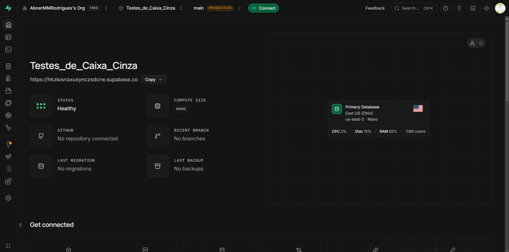

### AUTENTICAÇÃO HABILITADA

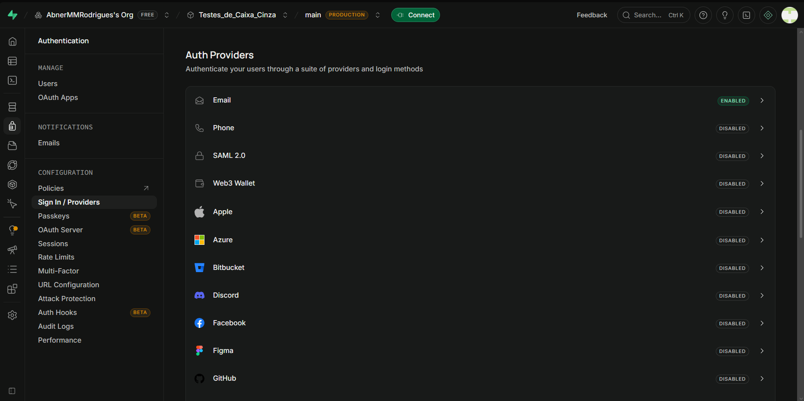

### USUÁRIO CRIADO

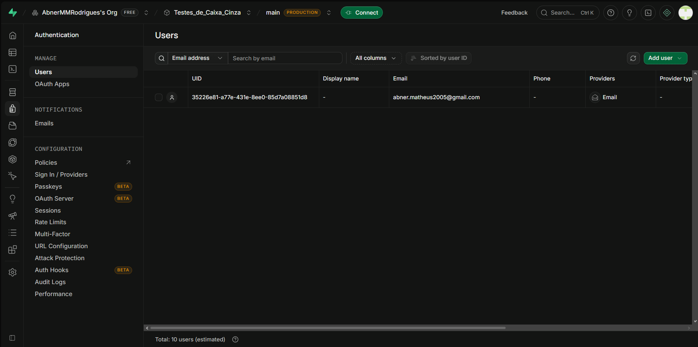

### CREDENCIAIS DA API

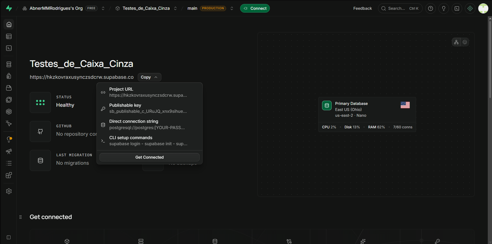

# Configuração do Postman

O processo de criação do banco no Supabase foi feito da seguinte maneira:

Baixar o CLI do Postman Desktop -> Criar uma Conta no Postman -> Criar um novo Workspace

Com o novo workspace criado, o primeiro passo é criar um Environment. Foi clicado no "+" ao lado da barra de pesquisa no topo da barra lateral esquerda, e selecionada a opção "Environment" para ser criado.

Com ele criado, as seguintes variaveis foram inseridas no mesmo:

**base_url:** base_url do projeto no supabase
**api_key:** api_key do usuario no supabase
**email:** email do usuario cadastrado no supabase
**senha:** senha do usuário cadastrado no supabase
**acess_token:** mesmo dado da API_Keuy

Após a configuração do Environment, no painel inicial do POSTMAN, selecione o Environment criado no topo superior direito para ele ser usado e o Postman conseguir ter acesso ao banco do Supabase.

### WORKSPACE

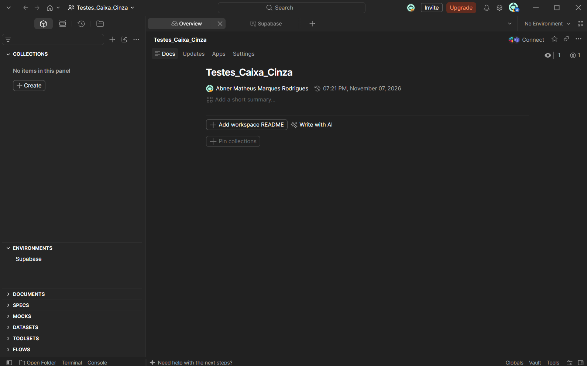

### ENVIRONMENT E VARIÁVEIS

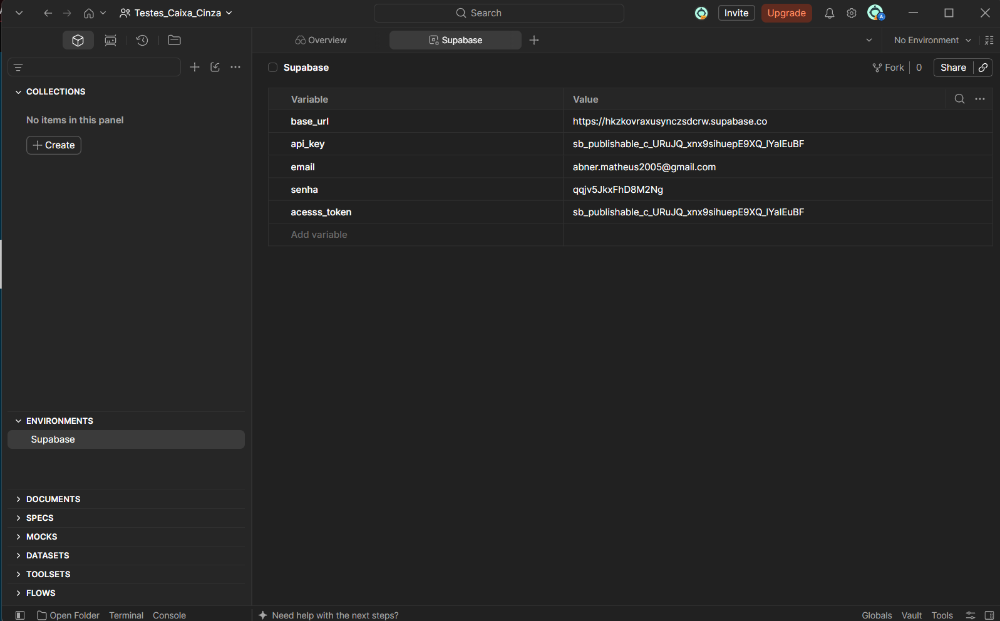

# Configuração das Requisições

Após a configuração do Environment, o próximo passo é criar uma COLLECTION, e dentro dela, criar as requisições para fazer os testes. Para criar a Collection, o mesmo processo para criar um Environment foi feito, porém a opção "Collection" foi selecionada para criar. 

Após a Collection ser criada, basta colocar o mouse sobre ela e clicar no "+" para criar uma nova requisição.

Essa requisição foi configurada da seguinte forma:

**Nome Utilizado:** Requisição 1 - Login

**Endpoint Utilizado:** {{base_url}}/auth/v1/token?grant_type=password

**Método HTTP Utilizado:** POST

**Header Utilizado:**

| Key | Value |
|---|---|
| api_key | XXXXX |
| Content-Type | application/json |

**Modelo de Body JSON utilizado:**

***{
  "email": "XXXXXX",
  "password": "XXXXXX"
}***

Após essa primeira requisição ser criada, ela foi duplicada e transformada em outras quatro requisições, com os seguintes nomes:

Requisição 2 - Senha Incorreta

Requisição 3 - Usuário Inexistente

Requisição 4 - Campos Vazios

Requisição 5 - Credenciais Inválidas

Se comparadas com a primeira requisição, as que foram feitas a partir dela apenas mudam o Body JSON, trocando os valores de e-mail e/ou password. Na requisição 4, o campo "email" é removido do Body JSON.

### REQUISIÇÃO

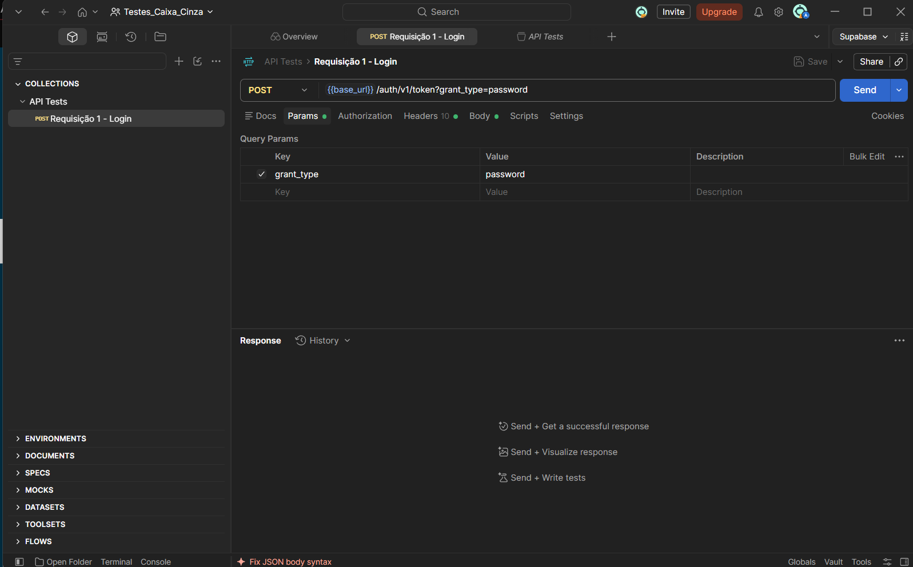

### HEADERS

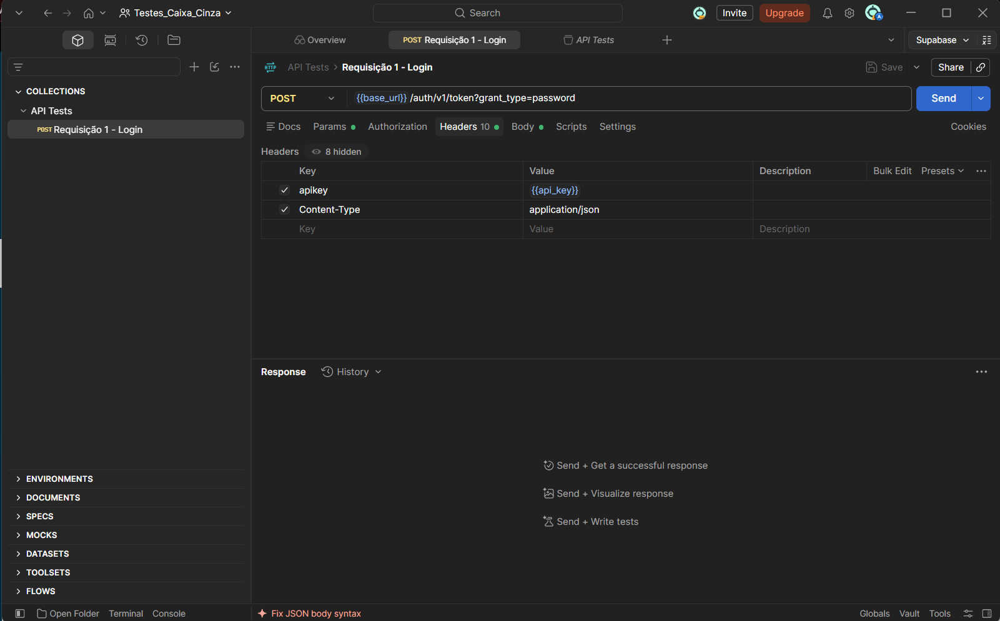

### BODY JSON

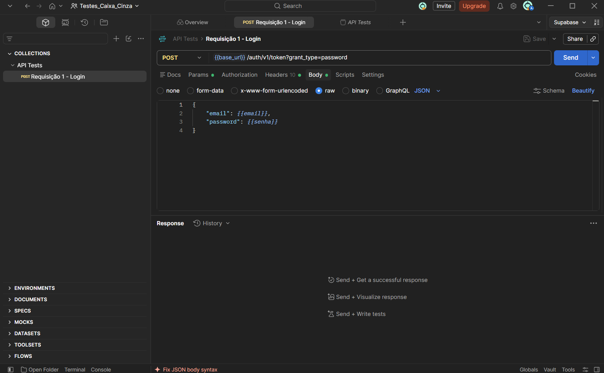

# Execução dos Testes

Foram executados os testes respectivos das 5 requisições criadas, sendo eles:

| Cenário | Entrada Utilizada | Resultado Esperado | Resultado Obtido | Status |
|---|---|---|---|---|
| Login Válido | Credenciais corretas | Status 200 | Sucesso | OK | 
| Senha Incorreta | Senha Errada | Status 400 | Sucesso | OK |
| Usuário Inexistente | Usuário não-cadastrado | Status 400  | Sucesso | OK |
| Campos Vazios | Sem Campo de Usuário | Status 400 | Sucesso | OK |
| Credenciais Inválidas | Credenciais Erradas | Status 400  | Sucesso | OK |

### Requisição 1 - Login

**Entradas Utilizadas:** "email": "{{email}}", "password": "{{senha}}"

**Resultado:** Sucesso - Código 200 + API_Key

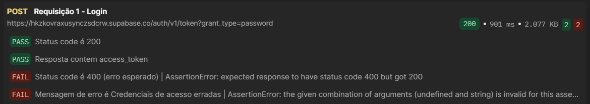
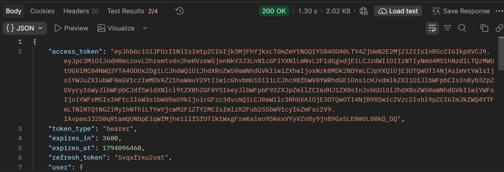

### Requisição 2 - Senha Incorreta

**Entradas Utilizadas:** "email": "{{email}}", "password": "123"

**Resultado:** Sucesso - Código 400 + Login Negado

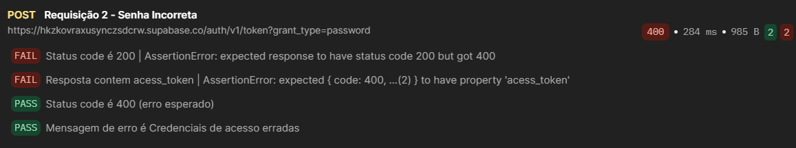
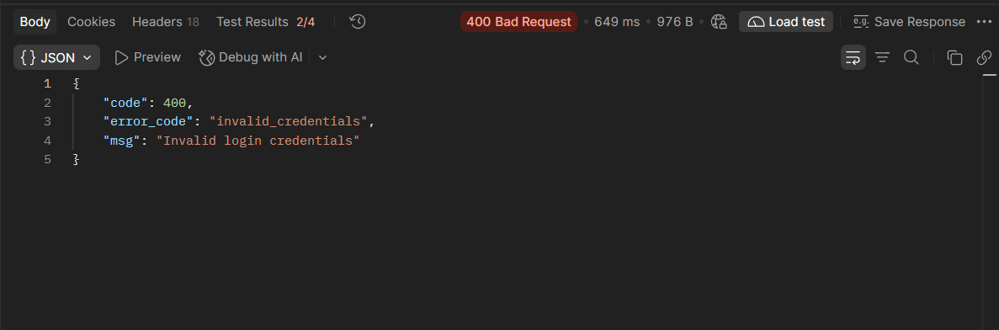

### Requisição 3 - Usuário Inexistente

**Entradas Utilizadas:** "email": "aaaa", "password": "{{senha}}"

**Resultado:** Sucesso - Código 400 + Login Negado

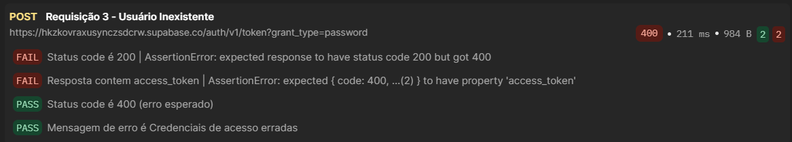
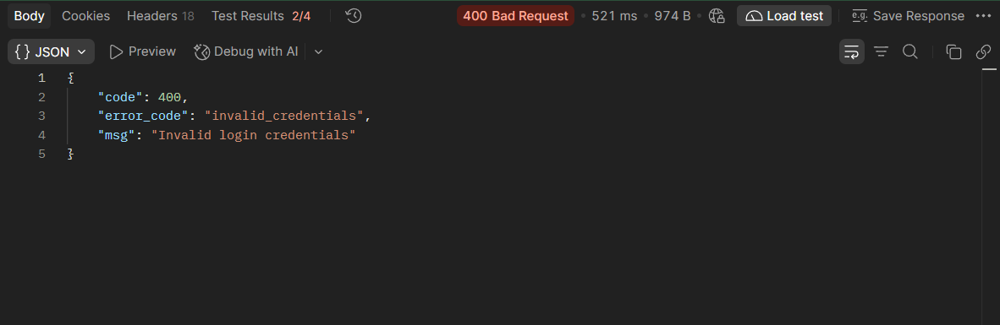

### Requisição 4 - Campos Vazios

**Entradas Utilizadas:** password": "{{senha}}"

**Resultado:** Sucesso - Código 400 + Login Negado

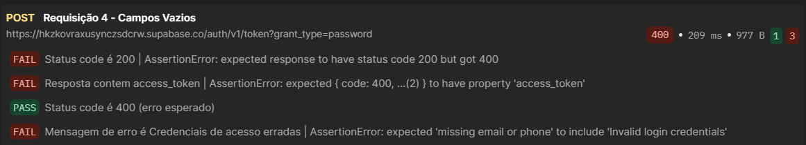
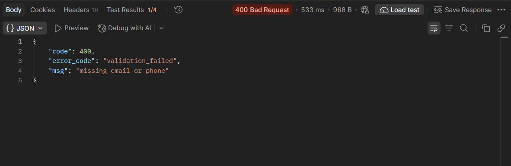

### Requisição 5 - Credenciais Inválidas

**Entradas Utilizadas:** "email": "abner", "password": "122"

**Resultado:** Sucesso - Código 400 + Login Negado

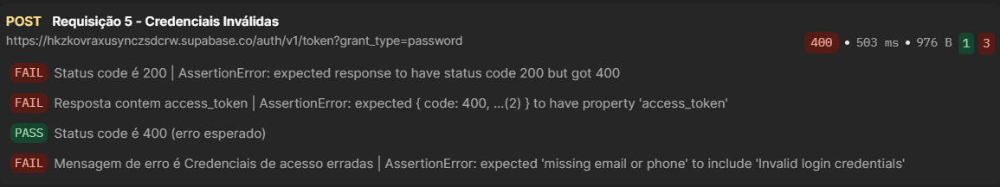
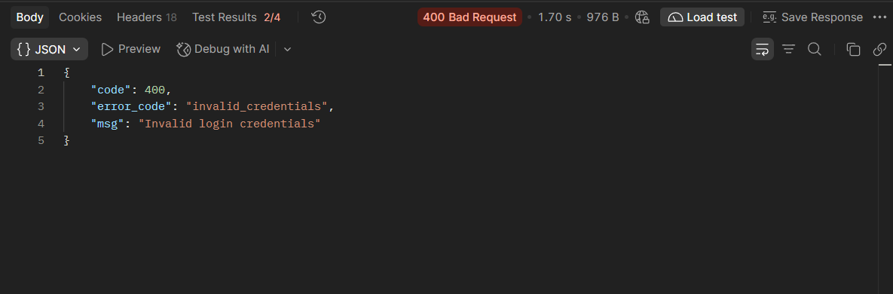

# Registro dos Testes

Após a conclusão dos testes, os resultados foram registrados em uma planilha utilizando o seguinte modelo:

| ID do Teste | Cenário | Entrada Utilizada | Resultado Esperado | Resultado Obtido | Mensagem de Erro | Status |
|---|---|---|---|---|---|---|
| XXX | XXX | XXX | XXX | XXX | XXX | XXX |

Esse registro foi realizado para fixar boas práticas, uma vez que, quanto mais registrado e documentado é um processo/projeto, mais fácil de consultar e achar erros é depois de finalizado.

### PLANILHA PREENCHIDA

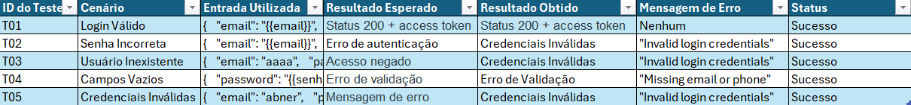

# Resultados Obtidos

# Conclusão
